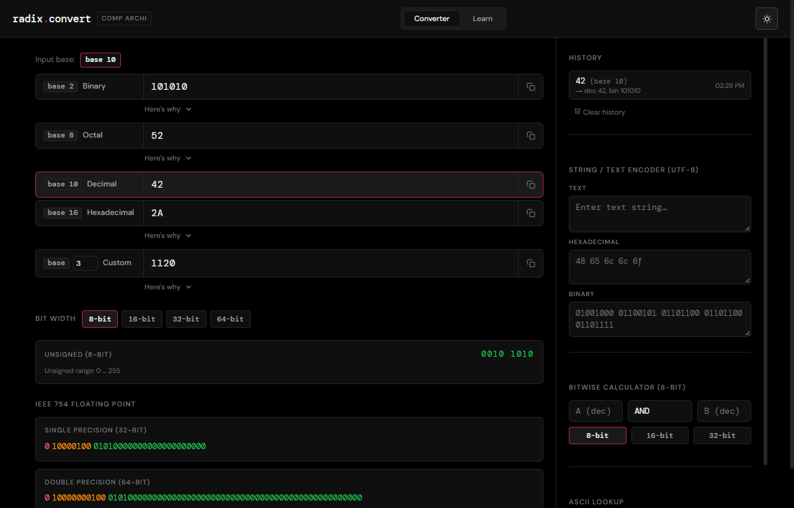

# Radix Convert

A number-system converter for binary, octal, decimal, hexadecimal, and any base
from 2 to 36. Type in one row and every other base updates as you go, with an
optional walkthrough of the arithmetic behind each conversion.



## What it does

- **Live conversion** between base 2, 8, 10, 16, and a custom base from 2 to 36.
- **Step-by-step working** for every conversion: positional weights, repeated
  division, or the decimal bridge for non-decimal pairs.
- **Fractions** such as `3.14` and `101.101`, truncated to 10 fractional digits.
- **Bit-width view** at 8, 16, 32, and 64 bits, including two's complement for
  negative values.
- **IEEE 754** single- and double-precision breakdown of the decimal value.
- **Bitwise calculator** (AND, OR, XOR, NOT, SHL, SHR) with fixed-width wrapping.
- **String encoder** between text, UTF-8 hex, and binary, with a per-byte
  explanation.
- **ASCII lookup** in both directions.
- **History** of the last 10 conversions, stored locally, click to restore.
- Dark and light themes, keyboard accessible, works offline after the first load.

## Accuracy

Integer conversion uses `BigInt`, so results stay exact well past
`Number.MAX_SAFE_INTEGER`. Fractional conversion uses exact rational arithmetic
rather than floating point, which means `0.1` decimal converts to
`0.0001100110` binary (the repeating expansion truncated at 10 digits) instead of
drifting. Bitwise operations wrap explicitly to the selected width instead of
relying on JavaScript's signed 32-bit operators.

## Development

```bash
npm install
npm run dev      # start Vite on http://localhost:5173
npm run test     # run the unit tests (Vitest)
npm run lint     # oxlint
npm run build    # production build into dist/
```

## Project layout

```
src/
  App.jsx                 layout, conversion state, history
  index.css               design tokens and all styling
  components/
    BaseInput.jsx         one editable base row with copy button
    StepPanel.jsx         collapsible worked example
    BitWidthSelector.jsx  unsigned and two's complement views
    Ieee754Viewer.jsx     32/64-bit float breakdown
    ExtrasContainer.jsx   string encoder, bitwise calculator, ASCII lookup
    HistoryPanel.jsx      recent conversions
    LearnPanel.jsx        long-form explainer
    ErrorBoundary.jsx     render-error fallback
  utils/
    convert.js            arbitrary-precision radix conversion
    stepwise.js           exact step generation
    bitwise.js            fixed-width bitwise maths
    ieee754.js            float bit fields
    ascii.js              character/code lookup
    history.js            persistence parsing and dedupe
```

## Notes

- Everything runs in the browser; there is no backend and no network calls
  other than the Google Fonts stylesheet.
- History and theme preferences live in `localStorage`, and storage failures
  (private mode, quota) are handled without breaking the UI.
